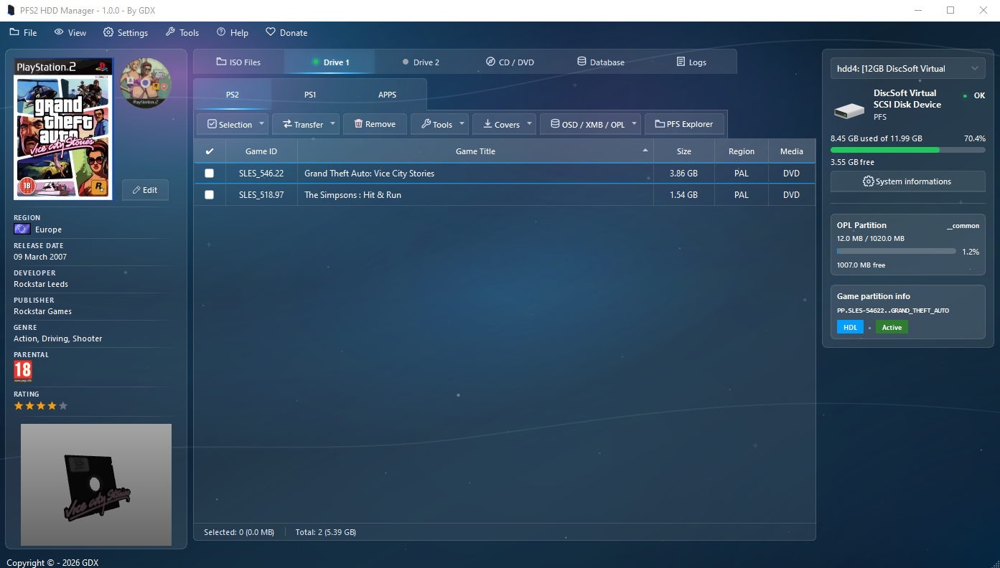
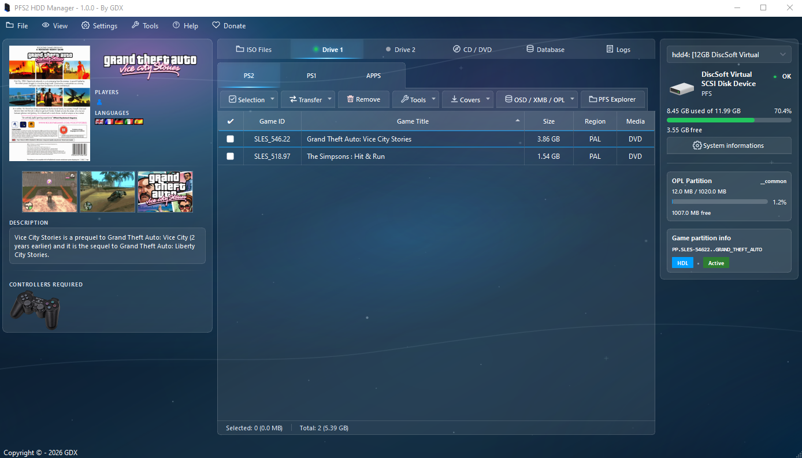

  

# PFS2 HDD Manager

A PlayStation 2 hard drive manager for Windows, designed to make game installation as simple as possible.
Install your games, manage partitions, and customize your game library.

[Downloads](https://github.com/GDX-X/PFS2-HDD-Manager/releases) · [Report an issue](https://github.com/GDX-X/PFS2-HDD-Manager/issues) · [Support me on Ko-fi](https://ko-fi.com/J3J6PIQ9O)

> [!WARNING]
> **Compatibility:** Only PFS-formatted hard drives are currently supported. Support for **FAT32** and **exFAT** will be added in a future update.

## Overview

### Your PS2 library, all in one place

Install and organize your PS2 and PS1 games, explore partitions, and manage your hard drive resources from a single interface.

### Make your collection your own

The artwork manager lets you browse, download, and replace game covers, disc artwork, logos, and screenshots. The CFG and CHT tabs also give you access to game configurations and cheat codes.

<table>
  <tr>
    <td width="50%" align="center" valign="top">
      
       Screenshot 1 — click to enlarge.
    </td>
    <td width="50%" align="center" valign="top">
      
       Screenshot 2 — click to enlarge.
    </td>
  </tr>
</table>

## Features

### Games and library

- Manage **PS2 and PS1** games with search, sorting, and filters.
- Install, extract, rename, and delete games on your hard drive.
- Copy games between two hard drives.
- PS1 game support through **POPS and EMBER**.
- Export PS2 games as **ISO** files and PS1 games as **VCD** files.
- Explore a rich game database with controller compatibility and support for **LAN**, **PS2 Online**, and **i.LINK** multiplayer.
- Compare MD5 hashes against Redump references.

### Drives and partitions

- Analyze drives and view available space.
- Format drives and manage partitions.
- Browse and transfer files with the **PFS** explorer.
- Customize partition headers and create boot partitions.
- Install system software, including **HDD-OSD**, and ELF applications.
- Rip physical CDs/DVDs to **ISO / BIN** images.

### Customization and resources

- Download and preview game covers, disc artwork, and 3D icons.
- Manage **Open PS2 Loader (OPL)** resources: applications, artwork, configurations, cheat codes, languages, themes, and virtual memory cards.
- Edit **CFG** and **CHT** files.
- Track transfers, view operation reports, and access built-in logs.
- Check for new versions directly from the application.

## Supported game formats

| Platform | Supported input formats |
| --- | --- |
| **PS2** | **ISO** (`.iso`) and **BIN/CUE** (select the `.cue` file). |
| **PS1 - POPS** | **BIN/CUE** (automatically converted to VCD during installation) and **VCD** (`.vcd`). |
| **PS1 - EMBER** | **BIN/CUE** (select the `.cue` file). VCD files are not supported by EMBER. |

**ZIP, 7Z, and RAR** archives containing supported game images can also be added directly and are extracted automatically.

## Getting started

1. Download the application from the [Releases](https://github.com/GDX-X/PFS2-HDD-Manager/releases) page.
2. Extract all files into a folder on your Windows PC.
3. Connect your PFS-formatted PS2 hard drive, then launch **PFS2 HDD Manager.exe**.
4. Accept the administrator permission request required to access drives.
5. Select the drive you want to manage and add your games from the files tab.

## Support my work

PFS2 HDD Manager is free to use. If you find my work useful, you can support me on **[Ko-fi](https://ko-fi.com/J3J6PIQ9O)** to help me keep developing and improving the project.

Thank you for your support, feedback, and ideas!

## Credits

Developed by **GDX**, using **[hdl_dump](https://github.com/ps2homebrew/hdl-dump)** and **[pfsshell](https://github.com/ps2homebrew/pfsshell)** for PS2 drive operations.
Credits and third-party component information are available in the application's **About** window.
